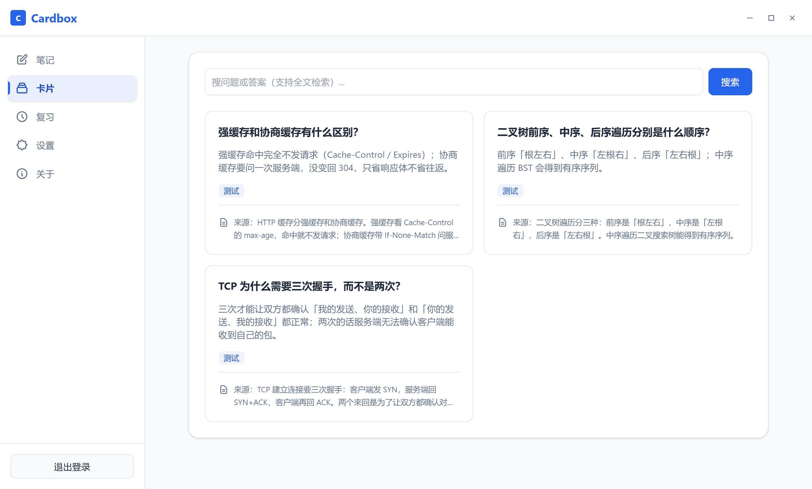
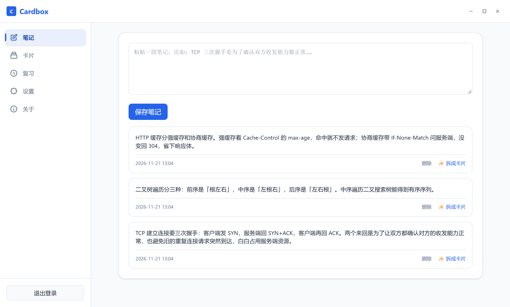
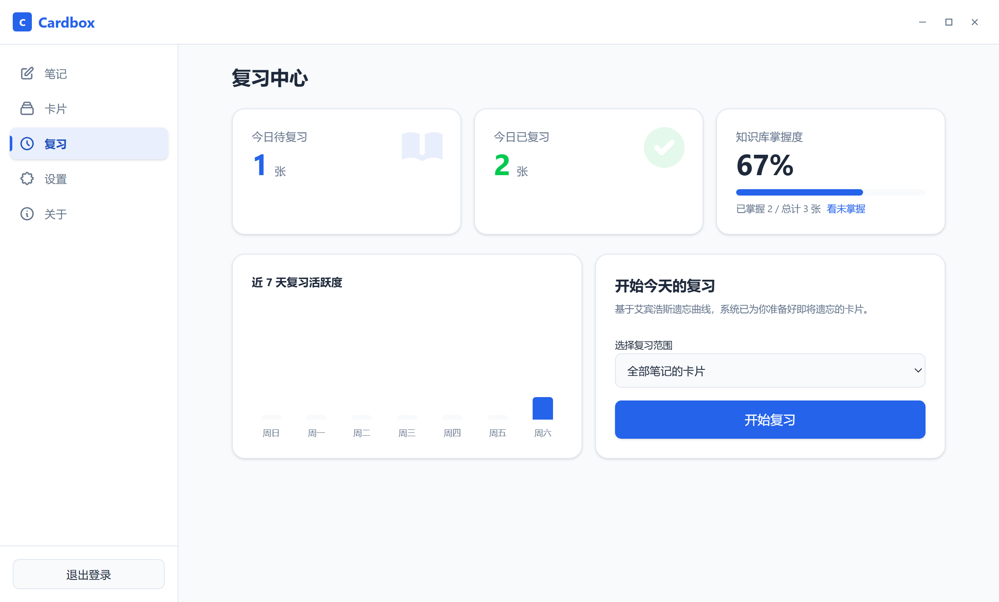
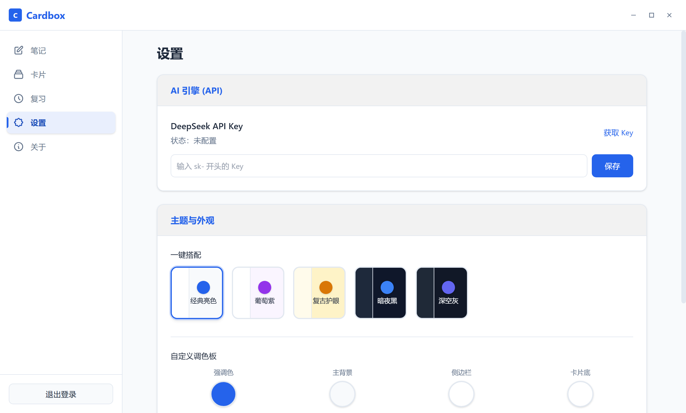
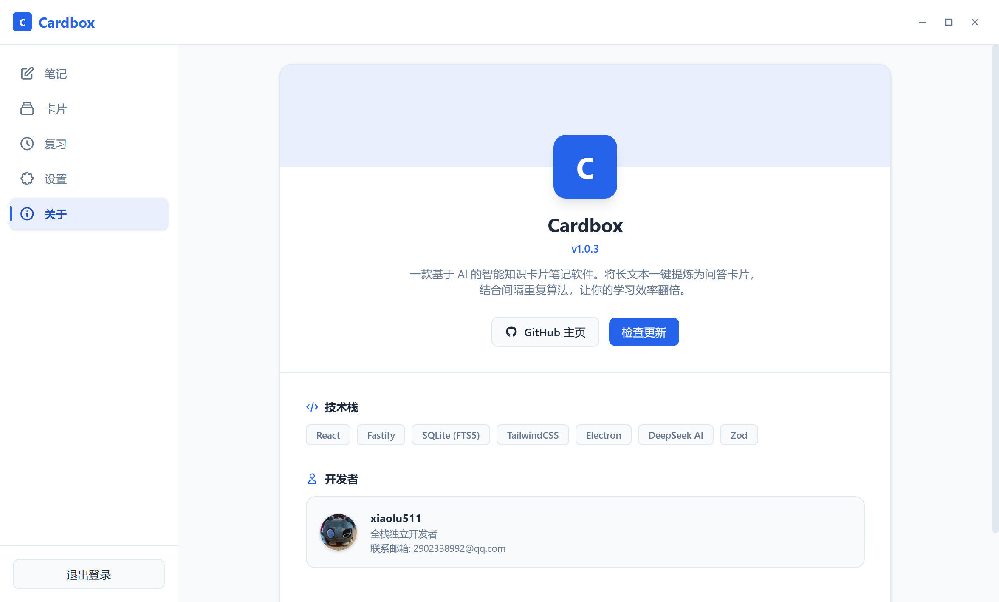

English | [简体中文](README.md)

# Cardbox

Feed a rough note to the AI and get back question-and-answer flashcards, scheduled by a spaced-repetition algorithm. Grade each card as you review it; the next appearance is worked out for you.

A single-user desktop app. All data stays on your machine.



| Notes | Review Center |
| :---: | :---: |
|  |  |
| **Theme settings** | **About** |
|  |  |

## Features

- **Notes → cards**: paste text and DeepSeek splits it into Q&A cards; the same card is never generated twice
- **Spaced repetition**: again / hard / good / easy, each with its own next-review date
- **Review Center**: due today / reviewed today / mastery, plus a 7-day activity chart. Click any card to see the list and drill those cards again
- **Full-text search**: SQLite FTS5 trigram index, with automatic LIKE fallback for short Chinese queries
- **Theming**: 5 presets, four colour pickers and custom fonts, applied instantly
- **Update check**: reads the latest GitHub Release and only prompts when it is newer than your build
- **Local first**: one SQLite file, API key never leaves the machine

Review history is stored server-side in a `review_log` table, so it survives a reinstall or a cleared browser cache.

## Tech stack

| Layer | Choice |
| --- | --- |
| Desktop shell | Electron 45 |
| Frontend | React 19 + Vite 8 + Tailwind CSS 4 |
| Backend | Fastify 5 |
| Storage | better-sqlite3 13 (with FTS5) |
| Model | DeepSeek API |

## Development

Requires Node.js 20+.

```bash
# Install (the root dependencies are used for packaging; web and server are separate)
npm install
npm install --prefix web
npm install --prefix server

# Configure the backend: copy the template, then paste your DeepSeek API key
# You can also set it in the app under Settings — that is stored in the database, not in a file
cp server/.env.example server/.env

# Start the backend (http://localhost:3000)
npm run dev --prefix server

# In another terminal, start the frontend (http://localhost:5173, /api proxied to 3000)
npm run dev --prefix web
```

## Packaging

```bash
npm run build --prefix web   # frontend build → web/dist
npm run build:app            # → dist/Cardbox Setup <version>.exe
```

> Quit the running Cardbox first. Otherwise electron-builder fails with `EBUSY ... Cardbox.exe` and **still exits with code 0**, which is easy to mistake for success.

## Project structure

```
main.cjs            Electron main process: starts the backend, creates the window, window-control IPC
preload.cjs         Minimal window-control bridge via contextBridge
server/src/         Fastify service: auth, notes, cards, review, search, settings
web/src/            React frontend: notes / cards / review / settings / about
web/src/theme.js    Single entry point for theme and custom fonts (all CSS variables are set here)
web/src/i18n.js     Translations: zh-CN / zh-TW / en
build/icon.ico      App icon
docs/               README screenshots
```

## Where the data lives

The packaged build keeps its database and JWT secret in `%APPDATA%\Cardbox\`:

```
cardbox.db       SQLite database (notes, cards, review log, API key)
jwt-secret       Random per-machine signing key, generated on first launch
```

In development mode the database goes to `server/data/`; set `DB_DIR` to move it elsewhere.

## License

[MIT](LICENSE)
