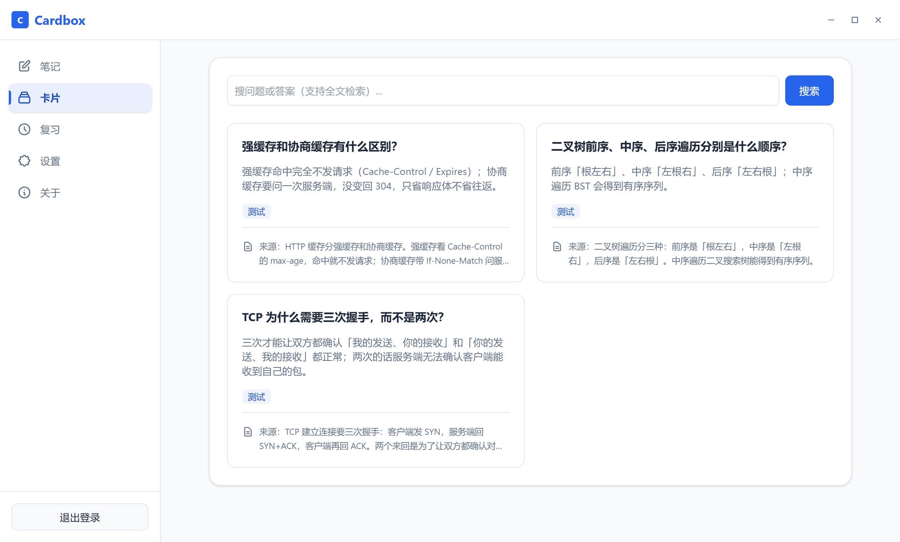
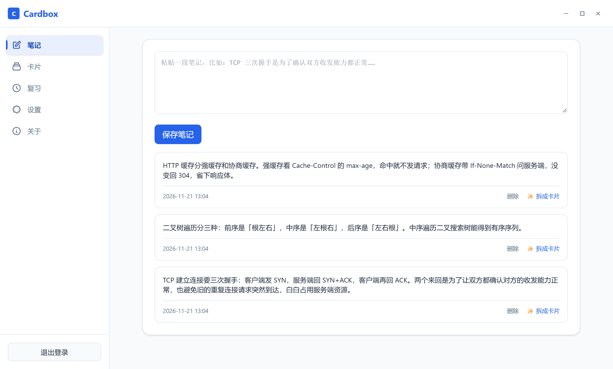
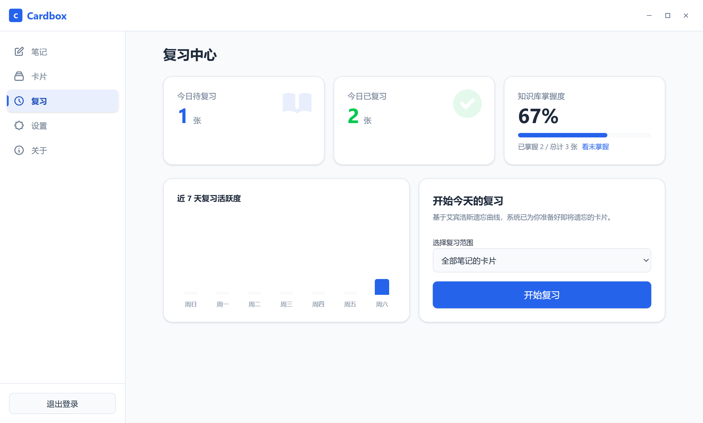

# Cardbox

把随手笔记交给 AI 拆成「问题 + 答案」知识卡片，按间隔重复算法排复习队列，复习时随手打分，下次自动按记忆曲线再出现在你面前。

桌面单机应用，数据全部留在本地。



| 笔记 | 复习中心 |
| :---: | :---: |
|  |  |

## 功能

- **笔记 → 卡片**：粘贴一段文字，DeepSeek 自动拆成多张问答卡片；同一张卡片不会重复生成
- **间隔重复复习**：again / hard / good / easy 四档打分，按记忆曲线算下次复习时间
- **复习中心**：今日待复习 / 今日已复习 / 知识库掌握度三张卡，配近 7 天复习活跃度；点开任意一张能看卡片明细，也可以直接「加练」
- **全文搜索**：SQLite FTS5 三元组索引，中文两字词自动回退 LIKE 匹配，搜「测试」也搜得到
- **主题自定义**：5 套预设配色 + 四色取色器 + 自定义字体，改动即时生效
- **检查更新**：从 GitHub Releases 读最新版本，比本地新才提示
- **本地优先**：SQLite 单文件存储，API Key 只保存在本机，不上传

复习记录由后端 `review_log` 表记账，换机器或清浏览器缓存都不会丢。

## 技术栈

| 层 | 选型 |
| --- | --- |
| 桌面外壳 | Electron 45 |
| 前端 | React 19 + Vite 8 + Tailwind CSS 4 |
| 后端 | Fastify 5 |
| 存储 | better-sqlite3 13（含 FTS5 全文索引） |
| 模型 | DeepSeek API |

## 开发运行

需要 Node.js 20+。

```bash
# 装依赖（根目录的依赖用于打包，前后端各自独立）
npm install
npm install --prefix web
npm install --prefix server

# 配后端环境变量：复制模板后填自己的 DeepSeek API Key
# 也可以在应用里的「设置」页填，存库不进文件
cp server/.env.example server/.env

# 起后端（http://localhost:3000）
npm run dev --prefix server

# 另开一个终端起前端（http://localhost:5173，/api 自动代理到 3000）
npm run dev --prefix web
```

## 打包

```bash
npm run build --prefix web   # 前端产物 → web/dist
npm run build:app            # → dist/Cardbox Setup <版本>.exe
```

> 打包前先退出正在运行的 Cardbox，否则 electron-builder 会报 `EBUSY ... Cardbox.exe`，而且**退出码仍然是 0**，容易误以为成功了。

## 目录结构

```
main.cjs            Electron 主进程：起后端、建窗口、窗口控制 IPC
preload.cjs         通过 contextBridge 暴露最小窗口控制接口
server/src/         Fastify 服务：认证、笔记、卡片、复习、搜索、设置
web/src/            React 前端：笔记 / 卡片 / 复习 / 设置 / 关于
web/src/theme.js    主题与自定义字体的唯一入口，CSS 变量都在这里设
build/icon.ico      应用图标
docs/               README 截图
```

## 数据存在哪

打包版本的数据库和 JWT 密钥都在 `%APPDATA%\Cardbox\`：

```
cardbox.db       SQLite 库（笔记、卡片、复习记录、API Key）
jwt-secret       每台机器首次启动随机生成的登录签名密钥
```

开发模式默认写到 `server/data/`，可以用 `DB_DIR` 环境变量改到别处。

## 许可

[MIT](LICENSE)
